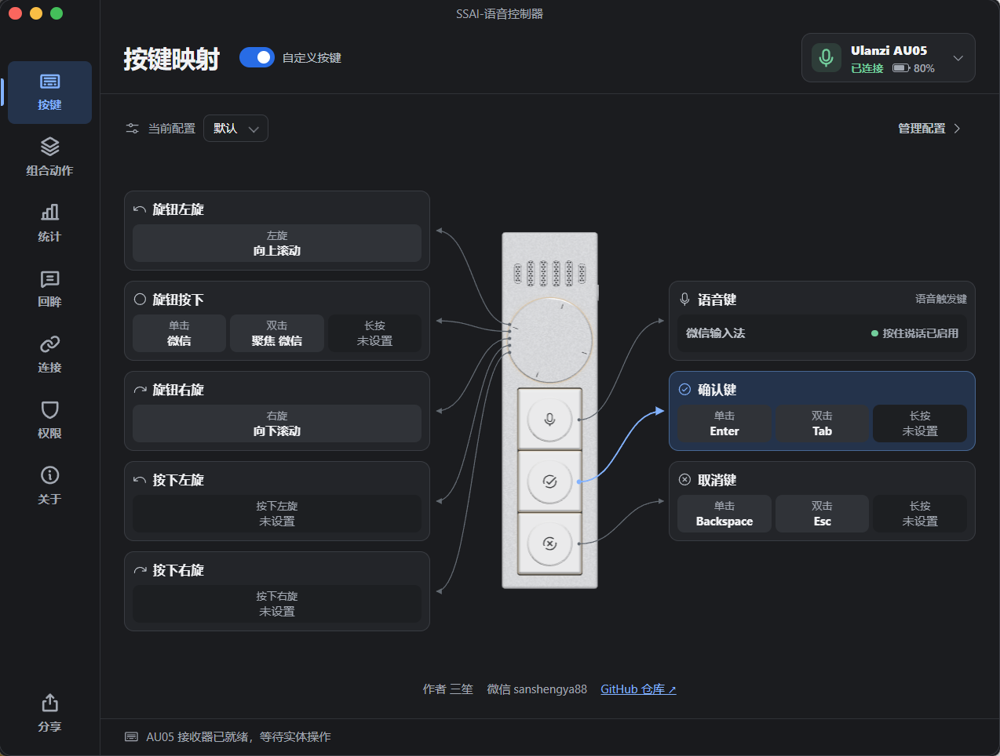

# SSAI-语音控制器

SSAI-语音控制器是一款为 Ulanzi AU05 设计的 Windows 桌面软件。你可以把打开应用、聚焦聊天框、滚动页面和常用快捷键分配给旋钮或按键。选好语音输入工具后，按住语音键说话，松开就能在当前输入框看到听写结果。

作者 **三笙** · 微信 **sanshengya88** · [GitHub 仓库](https://github.com/eddylu93/SSAI-yuyinkongzhiqi) · [下载正式版](https://github.com/eddylu93/SSAI-yuyinkongzhiqi/releases/latest)



以图中的微信配置为例：单击旋钮调出微信，双击旋钮聚焦聊天输入框，再按住语音键，用微信输入法听写。点击模型两侧的动作格可以修改绑定，例如把确认键的单击设为 Enter、双击设为 Tab。拖动中央模型可以从不同角度查看设备。

支持 Windows 10/11 x64，需要 WebView2 Runtime。

运行安装包即可安装或升级。升级时若软件仍在托盘运行，选择“确定”即可退出旧版并继续安装。安装后可从桌面或开始菜单打开软件，已有按键映射和语音设置会保留。如果安装器提示缺少 WebView2，请从提示中的微软官方下载页安装 Evergreen Runtime，再重新运行安装包。

软件启动时及运行期间每六小时检查 GitHub 正式发布版本。可在「关于 → 应用设置」手动检查更新。

## 第一次在 Windows 上使用

1. 首次运行进入连接向导。需要时可在「权限」页重新打开向导。插好 AU05 接收器、打开设备，启动 SSAI-语音控制器。点击右上角设备卡进入「连接」。接收器就绪表示系统已发现可监听的接口。输入报告计数和实体校准分别显示。
2. 查看机身状态。接收器在线、机身离线时，先唤醒或打开 AU05；确认接收器与机身配对。启用「设备直控」，等待接收器确认，程序即可按协议识别三个实体键和旋钮。
3. 勾选「测试按键」，依次操作。测试模式跨页面保持；连接页分别统计按松次数与左右旋转步数。手动关闭测试模式后恢复映射。语音键应出现 K1 down/up，确认和取消分别对应 K2/K3，转动旋钮会产生 turn，按住旋转会产生 heldTurn。若只使用设备原生键盘、鼠标或消费控制输出，可关闭设备直控，通过「识别实体控件」进行两轮相同操作并保存校准。
4. 在「麦克风」选 AU05，可主动试听 3 秒。Windows 内置听写使用已安装的中文系统语音识别器。选择「Windows 系统识别」，启用 K1 语音触发，关闭测试模式，把光标放到记事本，按住 K1 说话后松开。使用外部输入工具时，需在该工具中选 AU05 并设置相同快捷键。
5. 回到「按键」，点选动作格编辑普通按键、组合和常用语。主窗口关闭后保留托盘服务，通过托盘菜单退出。

用户设置、实体校准、常用语和可选历史保存在当前用户的 app.au05desk.desktop 数据目录。历史默认关闭。系统也可能处理接收器自身发送的标准键盘或鼠标动作，第一次校准请在空白测试窗口进行。

## 设备预览

按键映射页右上角根据 AU05 机身在线回包显示连接状态和电量。将鼠标移到中央模型上可改变观察角度，拖动可环绕查看。模型获得键盘焦点后，用方向键转动，Home 回到正面。

模型按普通版 AU05 的 112 × 30 × 28 mm 外廓和白色键帽重建。四组灯读取接收器的模式、灯效和亮度；工作模式的呼吸动画由本机绘制，设备未上报每一帧的光强或呼吸相位。离线或回读过期后预览熄灯。[官方尺寸](https://www.ulanzi.com/products/au05-vibe-key-ai-voice-input-keypad-i018) · [多角度外观照片](https://fccid.io/2BTBM-AU05/External-Photos/External-Photos-9620483)

## 开发与构建

Windows 需要 Node.js 22、Rust 1.89+、Python 3.12+、Windows C/C++ 工具链和 NSIS 3。运行以下脚本生成当前用户安装包及对应源码压缩包。

```powershell
.\scripts\build-windows.ps1
```

通过桌面程序的 `--hid` 参数枚举型号匹配的输入接口，`--devices` 枚举系统麦克风。使用 --receiver-status 可直接读取接收器回复的机身在线状态与电量。--test-device-session 会临时订阅按键并在数秒后释放，使用前通过托盘退出已运行的 SSAI-语音控制器。命令行输出宜重定向到文件。Windows 使用 Raw Input，macOS 有独立 HID 采集实现，尚待 Mac 验证。

[开发设计](docs/AU05开发设计.md) · [设备接入](docs/独立设备接入.md) · [验收记录](docs/构建发布与验收.md) · [第三方归属](vendor/README.md)

联调时，在现有应用已启用设备直控的情况下，可运行 `AU05Desk.exe --observe-input 20`。此命令只读取 AU05 接收器发布的报告，输出按松事件、旋转方向和相对时间。它不会切换订阅或打开麦克风。

[桌面界面设计规范](docs/UI设计规范.md)涵盖按键映射、设备连接、语音输入和桌面控件。

在「连接 → 灯光」读取并修改 AU05 的全亮、全灭或工作模式。全亮模式提供三档亮度，工作模式提供分灯设置。每次修改均读取设备回复确认结果。[AU05 普通版官方灯光说明](https://docs.ulanzistudio.com/vibekey/en/au05/#_2-4-lighting-modes)

在「按键」选择手势或编辑组合步骤，动作类型选择「快捷键」。点「录入快捷键」后，可以按键盘组合键，也可以在同一按钮上按鼠标左键、中键、右键、后退键或前进键。Windows 支持把鼠标键和 Ctrl、Alt、Shift 等修饰键组合使用。展开「虚拟键盘」也可以直接选择这些键。「连接 → 语音输入」使用同一个快捷键编辑器。

使用微信自带的语音输入时，在「连接 → 语音输入工具」选择「微信内置语音」，勾选「启用 K1 语音触发」。切回微信，把鼠标停在平时长按的位置（聊天输入框或语音按钮），按住 AU05 语音键说话，松开即释放鼠标左键。使用微信输入法的键盘听写时，选择「微信输入法」。

Windows 的「聚焦聊天框」动作可指定 Codex、豆包工作台、DeepSeek、Claude、WorkBuddy 或微信。在动作编辑器中选择目标后可先点「试聚焦聊天框」。选择器面向桌面客户端，需要目标应用提供可识别的聊天输入框。已有的 Codex 绑定继续生效。

桌面目标目录在 `src/focus-targets.json`。为新工作台添加稳定标识、显示名、客户端进程名、开始菜单名称和聊天输入框的辅助功能特征后，选择器、配置校验、映射描述和聚焦执行器都会使用这条记录。优先使用输入框可访问名称，并在同时存在搜索框、有草稿和多候选输入框时测试；仅显示窗口不算聚焦成功。
